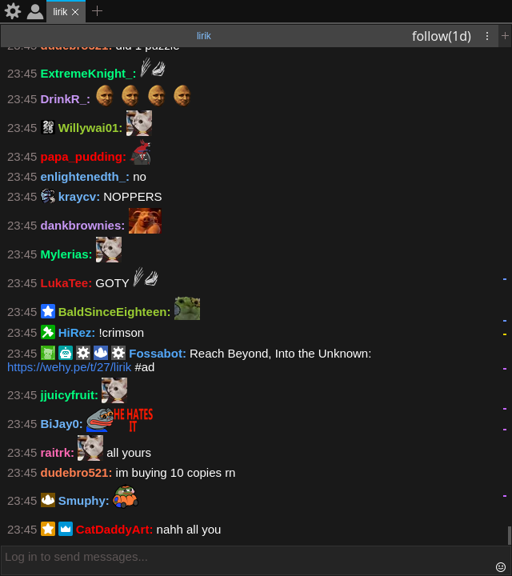
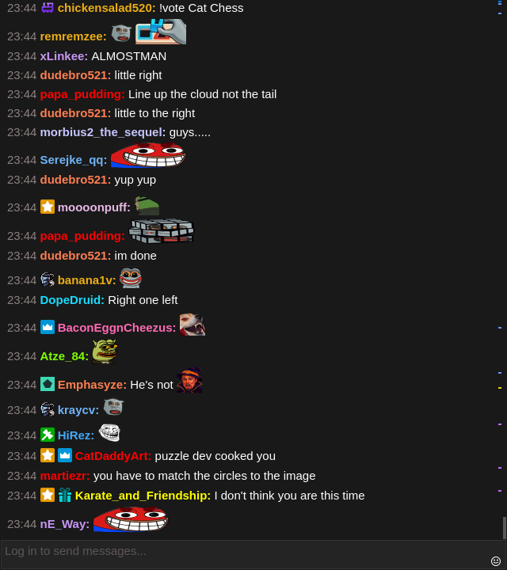
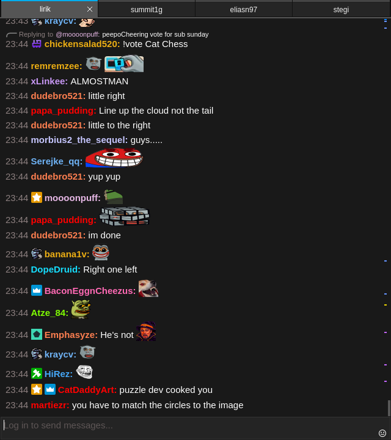
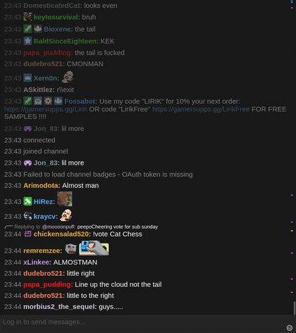

# chatterino-slim

A fork of [Chatterino 2](https://github.com/Chatterino/chatterino2), the Twitch chat client, whose window can be reduced to the chat, the input box and the emote button. Nothing is removed. Every part you can hide has a setting and a command-line flag, and stock Chatterino behavior is unchanged until you turn something on.

This is an unofficial fork and isn't affiliated with the Chatterino team. Report problems with it in [this repository's issues](https://github.com/beastyrabbit/chatterino-slim/issues), not upstream.

| Chatterino | chatterino-slim, one chat | chatterino-slim, four chats |
| --- | --- | --- |
|  |  |  |



The demo above as [video](docs/user/images/slim-demo.mp4): later launches add tabs to the running window, tabs are switched with the mouse, and the tab row disappears again when one chat is left.

## Why this fork exists

The fork started from one setup: streams on a tiling Wayland desktop, with the chat in a narrow column under the video, and a launcher in the desktop shell that opens a stream together with its chat. Stock Chatterino didn't fit that well:

- The tab bar, the channel header, the settings button and the account button cost space above every chat. In a column under a stream that space should go to messages.
- Tabs are sized to their names, so they're small targets. Under a video, chats are switched with the mouse, so tabs should be big.
- Every launch started a separate Chatterino window. Later launches should instead open their channel as a tab in the window that is already open, and close that tab again when the stream closes.

Upstream can already hide the settings and account buttons. This fork adds the rest. Each change is opt-in and small, so the fork can follow upstream releases automatically (see [Staying current](#staying-current-with-upstream)).

## What it adds

| What | Setting | Flag |
| --- | --- | --- |
| Hide the channel header above each chat | Advanced → Chat title → Show chat title | `--hide-split-header` |
| Hide the settings and account buttons | Hide preferences button, Hide user button (upstream) | `--hide-header-buttons` |
| Hide the `+` button after the tabs | Tabs → Show add tab button | `--hide-add-tab-button` |
| Show the tab row only from the second tab on | Tabs → Hide tabs while only one is open | `--hide-single-tab` |
| Tabs share the full window width | Tabs → Stretch tabs to the window width | `--fill-tabs` |
| All of the above for one session | | `--slim` |
| Later launches open tabs in this window | | `--instance <name>`, `--remove <channels>` |

Flags apply to the session only and never change your saved settings. Hiding all tabs with Ctrl+U is now remembered across restarts.

```sh
# A slim window that later launches add to
chatterino --slim --instance streams -c t:lirik

# Add a tab to it (this process exits right away), and close it again
chatterino --instance streams -c t:summit1g
chatterino --instance streams --remove t:summit1g
```

The window closes when its last tab is removed. The [user guide](docs/user/slim.md) covers every option, the shared instance and launcher setups.

## Install

chatterino-slim uses the same settings folder as Chatterino, so your accounts, highlights and layouts carry over. Don't run both at the same time.

**Linux archive.** Each [release](https://github.com/beastyrabbit/chatterino-slim/releases) has a `linux-x86_64.tar.gz` with Qt built in. It is tested on Ubuntu 22.04 and Arch Linux. Unpack it and run `bin/chatterino`. It uses X11, so on Wayland it runs through XWayland.

**Arch Linux, native Wayland.** Build the package from a checkout:

```sh
git clone --recurse-submodules https://github.com/beastyrabbit/chatterino-slim.git
cd chatterino-slim/packaging/arch
makepkg -si
```

Rebuild it after Qt updates. Chatterino uses Qt internals that change between Qt versions.

**From source.** Clone with `--recurse-submodules` and follow upstream's build guides for [Linux](BUILDING_ON_LINUX.md), [macOS](BUILDING_ON_MAC.md) or [Windows](BUILDING_ON_WINDOWS.md). Releases are built for Linux only.

## Staying current with upstream

A scheduled workflow checks upstream Chatterino every day. When upstream publishes a release, it merges the upstream commit that release was cut from and runs the full upstream test suite, the fork's own tests and a smoke test of the real binary. If everything passes, the merge lands on `main` and becomes a new release. If the merge conflicts or a test fails, nothing is merged. [docs/dev/slim-fork.md](docs/dev/slim-fork.md) explains how this works and what to do when it stops.

Release tags look like `v2.5.6-slim-alpha.1`: the Chatterino version the build is based on, then the fork's own channel and build number.

## Documentation

- [User guide](docs/user/slim.md): settings, flags, shared instances, launcher setup, troubleshooting
- [Developer guide](docs/dev/slim-fork.md): what the fork changes and where, tests, CI, releases and upstream merges
- [Fork changelog](SLIM_CHANGELOG.md)
- Everything else about Chatterino: the [Chatterino wiki](https://wiki.chatterino.com) and the [upstream README](https://github.com/Chatterino/chatterino2#readme)

## License

chatterino-slim is released under the [MIT license](LICENSE), like Chatterino. The copyright for Chatterino itself stays with its contributors. Third-party licenses are listed in [resources/licenses](resources/licenses) and [LICENSES](LICENSES). "Chatterino" and its logo belong to the Chatterino project. This fork uses the name only to say what it is based on.
